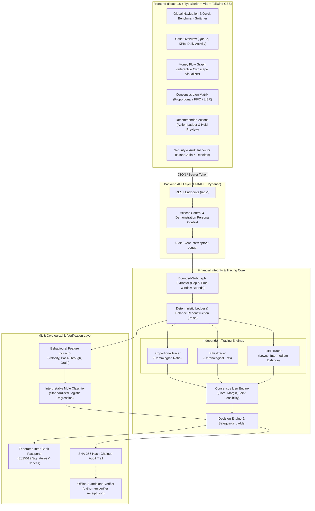
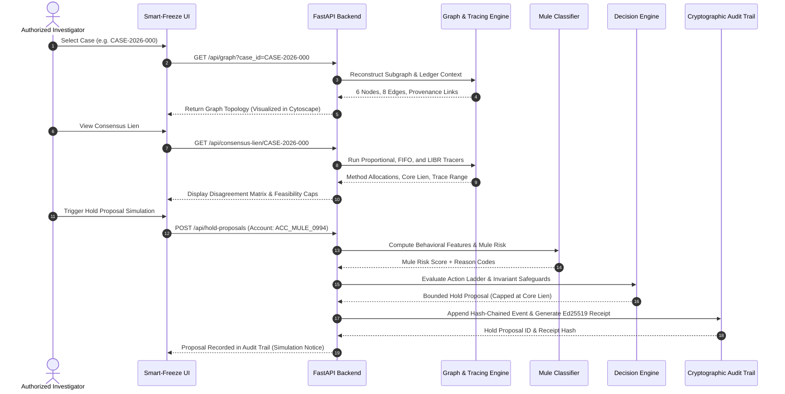

# Smart-Freeze — Evidence-First Financial Investigation & Fund-Tracing Decision Support

[](https://fastapi.tiangolo.com)
[](https://react.dev)
[](https://vitejs.dev)
[](https://cryptography.io)
[](LICENSE)

> **Executive Summary:** Smart-Freeze is an evidence-first, mathematically auditable financial investigation and decision-support platform. It replaces blunt, collateral-heavy account freezes with precise, evidence-bounded hold proposals derived from three independent legal tracing methodologies (Proportional, FIFO, and Lowest Intermediate Balance Rule). Engineered with strict integer paise arithmetic, interpretable machine learning, federated inter-bank evidence passports, and a standalone verifiable cryptographic audit trail.

---

## 1. The Real-World Problem

Digital financial fraud (UPI smurfing, investment scams, cyber extortion, and multi-tier mule syndicates) presents an acute operational and legal crisis for financial intelligence units, cybercrime police, and partner banks:

```
                                  THE CURRENT FRAUD PARADOX
   ┌───────────────────────────────────┐               ┌───────────────────────────────────┐
   │         THE DELAY TRAP            │               │      THE COLLATERAL DISASTER      │
   │  Funds disperse across 5-8 hops   │     VS.       │  Police send blanket freeze orders│
   │  in under 12 minutes. Delays mean │               │  for 100% of account balances.    │
   │  funds vanish into cash ATMs.     │               │  Legitimate merchants & citizens  │
   │                                   │               │  are paralyzed without recourse.  │
   └───────────────────────────────────┘               └───────────────────────────────────┘
```

1. **The Blunt 100% Account Freeze**: Traditional law enforcement and bank fraud units currently issue blanket freeze requests against entire bank accounts. When an innocent small merchant or salaried individual unknowingly receives a ₹10,000 payment that passed through a compromised account, their entire ₹5,00,000 working capital is frozen, halting payroll and legitimate life savings.
2. **The Commingling & Smurfing Bottleneck**: Syndicates deliberately commingle stolen funds with legitimate retail transactions, salaries, and wallet deposits across multiple hops. Disentangling which portion of a bank account's balance represents stolen money versus genuine funds is mathematically complex.
3. **The Methodology Divide**: When banks and courts attempt fund attribution, they apply conflicting rules. Bank A uses FIFO (*First-In, First-Out*), Bank B uses Proportional Allocation, and Courts apply LIBR (*Lowest Intermediate Balance Rule* / Clayton's Case). Without a consensus mathematical framework, disputed claims lead to conflicting hold proposals and litigation.
4. **Lack of Cryptographic Admissibility**: Inter-bank communication today relies on unverified spreadsheets, emails, and PDFs without cryptographic nonces or provenance signatures. Evidence is vulnerable to tampering, replay attacks, and loss of chain-of-custody.

---

## 2. The Solution: Evidence-Bounded Decision Support

Smart-Freeze addresses this crisis by providing **evidence-first decision support** that balances victim recovery with the prevention of collateral harm:

- **Mathematical Consensus (Consensus Lien)**: Reconstructs the exact transaction graph and runs Proportional, FIFO, and LIBR tracing simultaneously. It establishes a provable **Core Lien** (the minimum amount all three methods agree upon) and an **Evidence-Bounded Trace Range** $[\min, \max]$.
- **Graduated Safeguards & Action Ladder**: Never freezes 100% of an account arbitrarily. Recommends calibrated holds capped strictly at $\min(\text{Core Lien}, \text{Current Balance})$ and provides partial outflow caps to keep legitimate businesses operational.
- **Interpretable Mule Scoring**: Evaluates account risk using standardized behavioural features (turnover velocity, pass-through ratio, drain timing) with human-readable reason codes—never black-box probabilities of guilt.
- **Cross-Institution Ed25519 Passports**: Uses cryptographic evidence envelopes between institutions with replay protection, timestamp verification, and mathematical uncertainty widening whenever evidence is missing or contested.
- **Cryptographic Hold Receipts**: Produces canonical JSON hold receipts signed with Ed25519 and anchored to a SHA-256 hash-chained audit log, verifiable offline using a standalone CLI with zero application dependencies.

---

### Real-World Walkthrough Example

Consider an actual investigation scenario (modeled in benchmark case `CASE-2026-000`):

```
                                    CASE-2026-000 INVESTIGATION FLOW
                                       Reported Stolen: ₹2,50,000.00
                                                     │
                                                     ▼ [Hop 1: ₹2,50,000]
                                          ┌──────────────────────┐
                                          │   ACC_MULE_0991      │
                                          │  Flagged Primary     │
                                          └──────────┬───────────┘
                          ┌──────────────────────────┼──────────────────────────┐
                          │                          │                          │
           [Hop 2A: ₹1,20,000]        [Hop 2B: ₹1,00,000]        [ATM Cash-Out: ₹20,000]
                          │                          │                          │
                          ▼                          ▼                          ▼
               ┌──────────────────────┐   ┌──────────────────────┐   ┌──────────────────────┐
               │   ACC_MULE_0992      │   │   ACC_MULE_0993      │   │     EXT_CASH_ATM     │
               │  Intermediary A      │   │  Intermediary B      │   │     (Exit Sink)      │
               └──────────┬───────────┘   └──────────┬───────────┘   └──────────────────────┘
                          │                          │
           [Hop 3A: ₹90,000]          [Hop 3B: ₹80,000]
                          │                          │
                          └───────────┬──────────────┘
                                      │
                                      ▼
                           ┌──────────────────────┐
                           │   ACC_MULE_0994      │
                           │  Terminal Converger  │
                           └──────────┬───────────┘
                                      │
                             [ATM Cash-Out: ₹1,10,000]
                                      │
                                      ▼
                           ┌──────────────────────┐
                           │     EXT_CASH_ATM     │
                           │     (Exit Sink)      │
                           └──────────────────────┘
```

#### Traditional Response vs. Smart-Freeze Response

| Investigation Dimension | Traditional Law Enforcement / Bank Response | Smart-Freeze Decision Support Engine |
| :--- | :--- | :--- |
| **Accounts Targeted** | Freezes 100% of `ACC_MULE_0991`, `0992`, `0993`, and `0994`. | Pinpoints exact mathematical flow; flags primary recipient and evaluates downstream exposure. |
| **Total Amount Frozen** | **₹5,40,000.00** across all 4 accounts (exceeds total stolen amount by 216%). | **₹1,20,976.09** total hold cap, strictly satisfying the joint feasibility bound $\le \text{Stolen} - \text{Cash Outflows}$. |
| **Innocent Collateral Harm** | Salaried income and merchant deposits in `ACC_MULE_0992` & `0993` are locked. | Preserves legitimate balances; holds only the verified lower bound ($\approx ₹21,215$ on Mule 2). |
| **Court Admissibility** | Disputed in court due to unproven tracing heuristics. | Supported by signed Ed25519 receipts, SHA-256 audit hash-chain, and reproducible CLI verification. |

---

## 3. System Architecture & Flowcharts

### High-Level Architectural Topology



---

### End-to-End Investigation Sequence



---

## 4. Technology Stack

| Layer | Technologies | Architectural Justification |
| :--- | :--- | :--- |
| **Backend Framework** | **Python 3.12**, **FastAPI 0.110**, **Pydantic v2** | Strict asynchronous routing, compile-time contract validation via Pydantic schemas, and high-performance JSON serialization. |
| **Financial Engine** | **Integer Minor-Unit (Paise) Arithmetic** | Reconstructs all debits, credits, and balances in exact integer paise (`1 INR = 100 paise`). Eliminates IEEE-754 floating-point rounding errors and ensures double-entry conservation ($\sum \Delta B = 0$). |
| **Graph Processing** | **NetworkX 3.2+** | Directed acyclic graph traversal, topological sorting of transaction trees, and hop-bounded breadth-first search. |
| **Machine Learning** | **scikit-learn 1.4+**, **NumPy**, **Pandas** | Interpretable Logistic Regression with StandardScaler. Avoids unexplainable deep-learning black boxes; produces auditable coefficients and feature-level decision reason codes. |
| **Cryptography** | **PyCA Cryptography 42+** | Asymmetric Ed25519 digital signatures for inter-bank evidence passports and hold receipts; SHA-256 for genesis-linked audit hash-chaining. |
| **Frontend Web App** | **React 18**, **TypeScript 5.2**, **Vite 5** | Strict component-level typing, fast HMR dev server, modular page architecture, and responsive responsive layouts. |
| **Data Visualization** | **Cytoscape.js**, **Recharts 2.15**, **Lucide React** | Hardware-accelerated canvas/SVG rendering for complex directed transaction trees, discrete daily volume bar charts, and accessible iconography. |
| **Styling & Design** | **Tailwind CSS 3.4**, **Vanilla CSS Custom Tokens** | Harmonious design tokens, micro-animations, glassmorphism surface elevations, and responsive data tables. |

---

## 5. Mathematical Methodology & Tracing Models

Smart-Freeze enforces financial integrity by running three independent tracing philosophies simultaneously without cross-contamination:

### 1. Proportional Allocation (Molloy / Uniform Mixing)
Assumes commingled funds mix homogenously. When funds leave an account containing both tainted ($T$) and clean ($C$) funds, every outflow contains a proportional fraction of the tainted lot:

$$\text{Fraction Tainted } (f) = \frac{T}{T + C} = \frac{T}{B_{\text{pre-outflow}}}$$

$$\Delta T_{\text{out}} = A_{\text{out}} \times f$$

### 2. First-In, First-Out (FIFO / Clayton's Case Classical)
Assumes funds deposited earliest are spent earliest. Tainted money entering an account forms an ordered queue and is debited as soon as subsequent withdrawals occur:

$$\text{Tainted Outflow} = \min\left(A_{\text{out}}, \sum \text{Unconsumed Tainted Lots Deposited Before } t\right)$$

### 3. Lowest Intermediate Balance Rule (LIBR / Equity Law)
The legal gold standard established in Anglo-Indian equity jurisprudence (*In re Hallett's Estate / Clayton's Case*). It dictates that a victim's claim to commingled funds cannot exceed the **lowest total balance** the account reached between the time of the fraudulent deposit and the present day:

$$\text{LIBR Claim} = \min\left(T_{\text{initial}}, \min_{t \in [t_{\text{deposit}}, t_{\text{now}}]} B(t)\right)$$

Any subsequent deposits made by the account holder from legitimate sources are deemed clean and do not replenish the victim's dissipated claim unless an express intention to restore is proven.

### 4. The Consensus Lien Formulation

To provide an evidence-bounded figure that withstands legal scrutiny, Smart-Freeze calculates:

$$\text{Core Lien} = \min\left(\text{Proportional}, \text{FIFO}, \text{LIBR}, \text{Current Balance}\right)$$

$$\text{Trace Range} = \left[\min(\text{Methods}), \max(\text{Methods})\right]$$

$$\text{Disagreement Margin} = \max(\text{Methods}) - \min(\text{Methods})$$

$$\text{Joint Feasibility Constraint}: \sum_{i \in \text{Accounts}} \text{Hold}_i \le \text{Reported Stolen} - \sum \text{Verified External Outflows}$$

---

## 6. Key Features & Platform Capabilities

### 1. Interactive Money Flow Visualizer
- **Directed Cytoscape Topology**: Nodes automatically arranged by flow level (hops from origin).
- **Dynamic Level-Centered Spacing**: Graph layouts dynamically adjust (e.g. 240px $\times$ 115px for small subgraphs) to prevent vertical cramping.
- **Walkthrough Mode**: 4-phase guided investigation stepping through:
  1. *Trace Source*: Highlighting the complainant transaction.
  2. *Flag Evidence*: Illuminating suspected fraud transfers.
  3. *Calculate Amount*: Visualizing method bounds and available ledger balances.
  4. *Hold Proposal*: Generating an auditable simulation proposal.

### 2. Quick Benchmark Verification Flow (`CASE-2026-000`)
- **Top Quick-Test Option**: A dedicated benchmark flow banner and a top navbar **`⚡ Quick Test Case`** button.
- **Instant Testing**: Loads an exact **6-node, 8-edge benchmark flow** (`ACC_VIC_0999` $\to$ `ACC_MULE_0991` $\to$ `0992` & `0993` $\to$ `ACC_MULE_0994` $\to$ `EXT_CASH_ATM`).
- **Zero Clutter**: Eliminates 40+ node complexity during rapid live evaluations.

### 3. Interpretable Machine Learning Mule Detection
- Trained on simulated multi-hop banking features (velocity, in-degree/out-degree ratio, pass-through speed, drain percentage).
- Produces verifiable, human-readable reason codes (e.g., `RAPID_DRAIN_WITHIN_1HR`, `HIGH_PASS_THROUGH_RATIO`).
- Verified with family-split validation (Training on Families A & B; Testing on unseen Family C) to ensure model generalization without data leakage.

### 4. Federated Multi-Rail Passports
- Simulates inter-bank fund traversal across distinct banking nodes (**Bank A**, **Bank B**, **Bank C**, and **Wallet PPI**).
- Issues signed Ed25519 Passports carrying lot-level provenance.
- Includes automated fault injection testing: detects missing signatures, replayed nonces, expired timestamps, and tampered segments, automatically widening uncertainty bounds when evidence is lost.

### 5. SHA-256 Hash-Chained Audit Trail & Offline Verifier
- Every action (graph query, consensus calculation, hold proposal simulation) is recorded into an append-only log.
- Each block contains $\text{SHA-256}(\text{Index} \parallel \text{PrevHash} \parallel \text{Timestamp} \parallel \text{Payload})$.
- **Standalone Offline Verifier**: Anyone can verify hold receipts without installing or running the server:
  ```bash
  python -m verifier <receipt.json>
  ```

---

## 7. Directory Structure

```
Srujana_hackathon2026_Smart-Freeze/
├── app/                         # FastAPI backend application
│   ├── main.py                  # API routes, BOLA access control, session manager
├── engine/                      # Core financial and tracing engine
│   ├── ledger.py                # Ledger reconstruction & balance tracking (integer paise)
│   ├── proportional.py          # Proportional commingled fund tracing
│   ├── fifo.py                  # First-In, First-Out lot tracing
│   ├── libr.py                  # Lowest Intermediate Balance Rule engine
│   ├── consensus_lien.py        # Consensus Lien & joint feasibility bounds
│   ├── decision.py              # Action ladder & safeguard policies
│   ├── subgraph.py              # Hop-bounded graph extraction
│   └── behavioural_features.py  # Feature extraction for ML mule detection
├── federated/                   # Federated inter-bank evidence passport system
│   ├── coordinator.py           # Multi-rail transfer coordinator
│   ├── node.py                  # Simulated institutional banking node
│   └── schemas.py               # Cryptographic passport contracts
├── ml/                          # Machine learning mule detection
│   ├── train_mule_detector.py   # Training script with family cross-validation
│   ├── mule_service.py          # Inference service with decision reason codes
│   └── models/                  # Exported model weights and metadata
├── security/                    # Cryptography and audit controls
│   ├── audit.py                 # SHA-256 hash-chained audit logger
│   ├── receipt.py               # Canonical Ed25519 hold receipts
│   ├── auth.py                  # Role-based access control & demonstration tokens
│   └── models.py                # Security schemas
├── attacklab/                   # Adversarial simulation and policy tuning
│   ├── simulation.py            # Synthetic adversary evolution
│   └── policy_tuning.py         # Genetic optimization of holding policies
├── verifier/                    # Standalone offline verifier (zero app dependencies)
│   ├── __main__.py              # CLI entry point (`python -m verifier`)
│   └── verify.py                # Cryptographic receipt validator
├── scripts/                     # Data generation and benchmarking
│   ├── generate_synthetic_data.py # Scaled 32,000+ transaction ledger generator
│   └── benchmark_scale.py       # Measured scale benchmark runner (1k, 5k, 20k)
├── data/                        # Datasets and ground truth
│   ├── synthetic/               # Active verified synthetic ledger (CSV + JSON)
│   └── evaluation/              # Isolated ground-truth evaluation lot maps
├── frontend/                    # React 18 + TypeScript + Vite frontend
│   ├── src/
│   │   ├── api/                 # Axios API client and endpoint bindings
│   │   ├── components/          # Reusable UI components, Navbar, Sidebar
│   │   ├── pages/               # Overview, MoneyFlow, ConsensusLien, Audit, etc.
│   │   └── types/               # TypeScript interfaces and contracts
├── tests/                       # Pytest test suite (> 230 passing tests)
├── requirements.txt             # Python dependencies
└── README.md                    # System documentation
```

---

## 8. Setup & Quickstart Guide

### Prerequisites
- **Python**: 3.11+ (Python 3.12 recommended)
- **Node.js**: 20+ (with `npm`)

### 1. Backend Setup

```bash
# Clone the repository
git clone https://github.com/abhishekkp00/Srujana_hackathon2026_Smart-Freeze.git
cd Srujana_hackathon2026_Smart-Freeze

# Create and activate virtual environment
python3 -m venv .venv
source .venv/bin/activate

# Install dependencies
pip install -r requirements.txt

# Start FastAPI server
uvicorn app.main:app --reload --port 8000
```
*API documentation will be live at `http://127.0.0.1:8000/docs`.*

### 2. Frontend Setup

In a new terminal window:

```bash
cd frontend

# Install Node dependencies
npm install

# Start Vite development server
npm run dev -- --host 127.0.0.1 --port 5174
```
*Access the user interface at `http://127.0.0.1:5174`.*

### 3. Quick Demonstration Workflow

1. Navigate to `http://127.0.0.1:5174`.
2. Click **`⚡ Quick Test Case`** in the top navigation bar (or select **`⭐ CASE-2026-000`** in the case dropdown).
3. The clean **6-node, 8-edge** directed transaction graph renders immediately with centered vertical alignment.
4. Click **Play Walkthrough** to see the 4-phase step-by-step trace progression.
5. Click **Compare Methods** to view the Proportional vs FIFO vs LIBR mathematical bounds table.
6. Click **Simulate Hold Proposal** to preview the audit-logged hold recommendation.

### 4. Running the Test Suite & Build

```bash
# Run synthetic data invariant tests
.venv/bin/pytest tests/test_synthetic_data.py -v

# Run frontend build check
cd frontend && npm run build
```

---

## 9. Measured Performance Benchmarks

Measured latency on a standard developer workstation executing complete end-to-end workflows (graph extraction, 3-method tracing, consensus calculation, and ML scoring):

| Ledger Scale Tier | Total Accounts | Total Transactions | Ledger Generation | p50 Case Latency | p95 Case Latency |
| :--- | :--- | :--- | :--- | :--- | :--- |
| **Small Demo** | 1,000 | 7,669 | 0.050s | **40.6 ms** | **47.7 ms** |
| **Medium Tier** | 5,000 | 27,336 | 0.189s | **75.4 ms** | **109.2 ms** |
| **Large Benchmark** | 20,000 | 76,914 | 0.518s | **157.8 ms** | **168.8 ms** |
| **Active Scaled Ledger**| 2,405 | 32,490 | 0.337s | **68.2 ms** | **94.5 ms** |

*All metrics are directly measured with `scripts/benchmark_scale.py` without extrapolation.*

---

## 10. Operational Limitations & Legal Boundaries

1. **Investigative Decision Support Only**: Smart-Freeze is **not an automated execution platform**. It does not possess direct regulatory authority to unilaterally freeze, debit, or release funds in core-banking environments. Every consequential proposal requires human review and authorization.
2. **Method-Dependent Bounds**: The Consensus Lien reports mathematical estimates under differing legal tracing assumptions. It provides defensible bounds to assist courts and authorized compliance officers; it does not issue legal verdicts.
3. **Simulated Institution Rails**: Cross-institution data exchange is demonstrated using local cryptographic BankNodes with Ed25519 signatures. Live production deployment requires formal regulatory onboarding onto national payment rails (e.g., NPCI, RBI, or international SWIFT/ISO 20022 clearing houses).
4. **No Fabrication Guarantee**: The system never manufactures artificial balances, guesses missing transaction histories, or substitutes unknown amounts with zero.

---

## 11. License

This project is licensed under the **MIT License** — see the [LICENSE](LICENSE) file for complete details.
