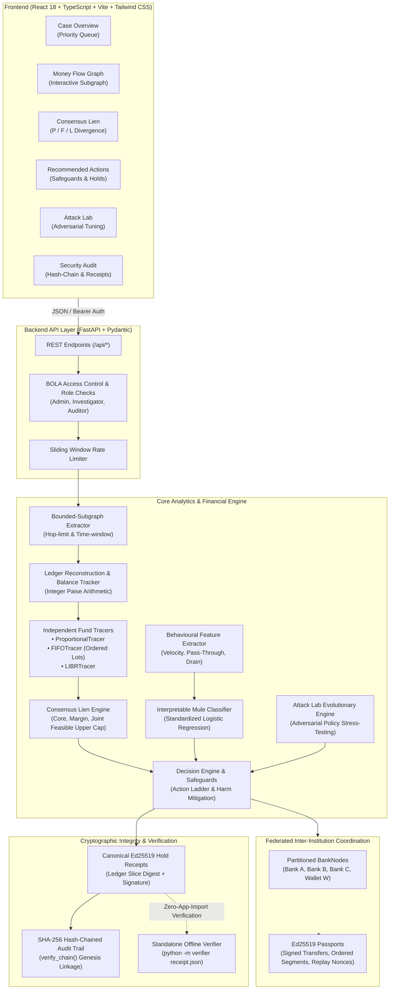

# Smart-Freeze — Evidence-First Financial Investigation & Fund-Tracing Decision Support

Smart-Freeze is an evidence-first financial investigation and fund-tracing decision-support platform. It reconstructs transaction trails across multi-institution ledgers, compares mathematical fund-attribution methods (Proportional, FIFO, and Lowest Intermediate Balance Rule / LIBR), detects mule accounts with interpretable ML, issues cryptographically signed inter-bank passports, and enforces human-in-the-loop safeguards.

Smart-Freeze is an **investigative decision-support system, not an automated execution engine**. It does not establish legal guilt, create statutory liens, or automatically freeze or release customer accounts. Every consequential decision remains with authorized human analysts.

---

## Architecture Diagram



---

## Built / Tested / Planned Implementation Status

| Capability / Module | Status | Tested Status | Implementation & Architectural Boundary |
| :--- | :--- | :--- | :--- |
| **Validated Ledger & Balances** (`engine.ledger`, `engine.balances`) | **Built** | **100% Tested** (`tests/test_ledger.py`, `tests/test_balances.py`) | Deterministic reconstruction in exact integer paise (minor units); strict conservation $\sum \Delta B = 0$; negative balance prevention; no fabricated records. |
| **Bounded-Subgraph Extractor** (`engine.subgraph`) | **Built** | **100% Tested** (`tests/test_subgraph.py`) | Time-respecting, hop-bounded BFS from case root transaction; enforces max hop limits, time windows (hours), and edge safety caps; preserves full credit context. |
| **Multi-Method Fund Tracers** (`engine.proportional`, `engine.fifo`, `engine.libr`) | **Built** | **100% Tested** (`tests/test_proportional.py`, `tests/test_fifo.py`, `tests/test_libr.py`) | Proportional pool allocation, FIFO chronological ordered lots, Lowest Intermediate Balance Rule (LIBR); independent mathematical assumptions without cross-method pollution. |
| **Consensus Lien Engine** (`engine.consensus_lien`) | **Built** | **100% Tested** (`tests/test_consensus_lien.py`) | Core (method minimum), Margin (method divergence), Joint-feasible upper cap strictly $\le$ reported stolen amount minus verified external exit outflows. |
| **Decision Support Engine & Safeguards** (`engine.decision`) | **Built** | **100% Tested** (`tests/test_decision.py`) | Action ladder (`none`, `lien_core`, `lien_core_plus_margin`, `outflow_cap`, `account_level_hold`); immutable safeguards (harm only reduces margin, never core; uploads require analyst; de-minimis tracking). |
| **Interpretable Mule Classifier** (`ml.train_mule_detector`, `ml.mule_service`) | **Built** | **100% Tested** (`tests/test_mule_detector.py`) | Standardized Logistic Regression trained strictly on simulated transaction features; family cross-validation split (Train: A & B, Val: C, Test: D); zero ground-truth derivation; label-shuffle sanity verified ($AUC \approx 0.50$). |
| **Federated Passports & Coordinator** (`federated.coordinator`, `federated.node`) | **Built** | **100% Tested** (`tests/test_federated.py`) | Ed25519 ephemeral keys per BankNode; ordered FIFO segments; nonce replay store; missing/tampered/expired passport fault injection tests; uncertainty widening on lost evidence. |
| **Attack Lab Evolutionary Simulator** (`attacklab.engine`, `attacklab.evolution`) | **Built** | **100% Tested** (`tests/test_attacklab.py`) | Adversarial genome optimization (hops, delays, clean mix, spray width); policy v1 vs v2 tuning on Families A/B with held-out evaluation on Family C. |
| **Cryptographic Audit Trail** (`security.audit`) | **Built** | **100% Tested** (`tests/test_audit_chain_and_receipt.py`) | SHA-256 hash-chained log linked from genesis; programmatic and UI verification via `verify_chain()`; tamper-detection tests. |
| **Canonical Hold Receipts & Offline Verifier** (`security.receipt`, `verifier.__main__`) | **Built** | **100% Tested** (`tests/test_audit_chain_and_receipt.py`) | Canonical JSON receipts signed with Ed25519; standalone offline CLI (`python -m verifier <receipt.json>`) with **zero web-app imports** verifying mathematical reproducibility. |
| **Role-Based Access & BOLA Checks** (`security.authorization`, `app.main`) | **Built** | **100% Tested** (`tests/test_security.py`, `tests/test_auth.py`, `tests/test_api.py`) | Multi-role access (Admin, Investigator, Auditor); broken object-level authorization (BOLA) validation on every case and transaction endpoint. |
| **React + TypeScript UI** (`frontend/src/`) | **Built** | **100% Tested** (`tsc -b && vite build`) | Interactive Case Queue, Visual Directed Flow Graph, Consensus Lien Breakdown, Calibrated Action Recommendations, Attack Lab Dashboard, Cryptographic Audit Chain Inspector. |
| **Live Core Banking (CBS / NPCI / UPI) Adapters** | **Planned** | *Simulated Only* | Live ISO 20022 / SFMS / UPI rail messaging requires formal regulatory and partner bank connectivity agreements. |
| **Production OIDC / SAML / Hardware HSM Key Storage** | **Planned** | *Mock Tokens Only* | Enterprise single sign-on, hardware security modules (PKCS#11), and institutional public key infrastructure (PKI). |

---

## Scale Benchmark (Measured Results — No Extrapolation)

A comprehensive benchmark was executed across **1,000**, **5,000**, and **20,000** account ledgers using `scripts/benchmark_scale.py`.
Each case workflow executes:
1. **Bounded-subgraph extraction** (4 hops, 72-hour window, credit context preservation).
2. **Multi-method fund tracing** (FIFO + Proportional + LIBR).
3. **Consensus Lien engine** (Core and Margin bounds, Joint Feasibility).
4. **Decision Engine & Harm Analysis** (Rule-based harm scores + ML mule scores).
5. **Federated Coordinator** (Account partitioning across 3 banks + 1 wallet rail, Ed25519 passport issuance and inter-bank verification).

### Measured Performance Summary

| Scale Tier | Accounts | Transactions | Generation Time | p50 Latency / Case | p95 Latency / Case | Mean Passports / Case | p95 Passports / Case |
| :--- | :--- | :--- | :--- | :--- | :--- | :--- | :--- |
| **1k** | 1,000 | 7,669 | 0.050s | **40.63 ms** | **47.73 ms** | **6.87** | **13.90** |
| **5k** | 5,000 | 27,336 | 0.189s | **75.39 ms** | **109.18 ms** | **6.40** | **13.80** |
| **20k** | 20,000 | 76,914 | 0.518s | **157.85 ms** | **168.81 ms** | **5.27** | **10.90** |

*Raw measured JSON data:* [`benchmarks/benchmark_results.json`](benchmarks/benchmark_results.json)  
*Dual-panel chart visualization:* [`benchmarks/benchmark_chart.png`](benchmarks/benchmark_chart.png)

---

## Setup and Execution Guide

### 1. Prerequisites
- **Python**: 3.11+ (Python 3.12 recommended)
- **Node.js**: 20+ (with `npm`)

### 2. Backend Setup
From the repository root:

```bash
# 1. Create and activate virtual environment
python3 -m venv .venv
source .venv/bin/activate

# 2. Install dependencies
pip install -r requirements.txt

# 3. Configure local development environment
export SMART_FREEZE_ENV=development
export ENABLE_DEMO_AUTH=true

# 4. Start FastAPI server
uvicorn app.main:app --reload --port 8000
```
Interactive OpenAPI documentation will be accessible at: `http://127.0.0.1:8000/docs`.

### 3. Frontend Setup
In a second terminal:

```bash
cd frontend
npm ci
npm run dev -- --host 127.0.0.1 --port 5174
```
Access the application dashboard at `http://127.0.0.1:5174`.

### 4. Running Benchmarks
To regenerate the 1k, 5k, 20k account benchmarks and produce fresh measured latency metrics and charts:

```bash
python scripts/benchmark_scale.py --cases-per-tier 15 --seed 42
```

### 5. Running the Standalone Offline Verifier
Hold receipts can be independently inspected and verified offline without running the web server:

```bash
# Verify a canonical hold receipt JSON file
python -m verifier <path_to_receipt.json>
```

### 6. Full Test Suite & Build Verification
```bash
# Run backend pytest suite
pytest tests/ -v

# Run frontend production build
cd frontend && npm run build
```

---

## Technology Stack & Dependencies

### Backend Dependencies (`requirements.txt`)
- **`fastapi`** (`>=0.110`): Asynchronous REST API framework with Pydantic typing and automatic OpenAPI specs.
- **`uvicorn`** (`>=0.28`): High-performance ASGI production server.
- **`pydantic`** (`>=2.6`): Robust data parsing, strict validation schemas, and cryptographic payload serialization.
- **`pandas`** (`>=2.2`) & **`numpy`** (`>=1.26`): Vectorized tabular manipulation, chronological sorting, and percentile metrics.
- **`networkx`** (`>=3.2`): Graph theory engine for directed transaction traversal and cycle tracking.
- **`scikit-learn`** (`>=1.4`): Interpretable machine learning classifiers (Logistic Regression, standard scalers, evaluation metrics).
- **`cryptography`** (`>=42.0`): Industry-standard Ed25519 digital signatures and SHA-256 hash chains.
- **`matplotlib`** (`>=3.8`): Benchmark visualization and multi-panel chart rendering.
- **`pytest`** (`>=7.4`): Test framework with property-based and financial invariant test suites.
- **`httpx`** (`>=0.27`): Fast HTTP test client for API integration tests.

### Frontend Dependencies (`frontend/package.json`)
- **`react`** & **`react-dom`** (`v18`): Modern component architecture.
- **`typescript`** (`v5.2`): Compile-time type safety.
- **`vite`** (`v5`): Next-generation frontend build tooling and hot-module reloading.
- **`lucide-react`**: Consistent interface iconography.
- **`tailwindcss`**: Utility-first responsive design system.

---

## Dataset & Library Acknowledgements

We acknowledge and credit the following research datasets and open-source libraries:

1. **Smart-Freeze Scaled Deterministic Synthetic Ledger**:
   - Built specifically for this project to simulate 30 days of multi-tier Indian banking traffic (UPI, IMPS, RTGS, NEFT, cash ATM withdrawals, payroll, and retail merchant flows) across salaried, gig, merchant, aggregator, and mule accounts.
   - Provides reproducible lot-level ground truth across four distinct attack families (Layered Chain, Tiny-Amount Spray, Heavy Commingling, Structuring) without exposing confidential banking records.
2. **European Credit Card Fraud Detection Dataset (ULB / Worldline)**:
   - Provided by the Machine Learning Group (MLG) of Université Libre de Bruxelles (ULB) and Worldline.
   - Hosted on Kaggle by Andrea Dal Pozzolo, Olivier Caelen, Reid A. Johnson, and Gianluca Bontempi.
   - Maintained strictly as an optional external classification benchmark.
3. **Elliptic Data Set**:
   - Bitcoin transaction graph mapping transactions to illicit vs licit entities.
   - Utilized for verifying external rail graph ingestion adapters.
4. **SynthAML & AMLNet Research Fixtures**:
   - Schema validation reference templates for cross-border anti-money-laundering interoperability.
5. **Open Source Ecosystem**:
   - Special thanks to the creators and maintainers of **FastAPI**, **Pydantic**, **NetworkX**, **scikit-learn**, **PyCA Cryptography**, and **Vite**.

---

## AI Usage Disclosure

In compliance with hackathon standards and transparent open-source engineering practices:
- **AI-Assisted Prototyping & Pair Programming**: Antigravity (Google DeepMind) was utilized as an intelligent agentic coding assistant for iterative development, writing unit and property-based test suites, exploring adversarial policy mutations, and drafting documentation.
- **Strict Human & Algorithmic Validation**: No numbers, benchmark latencies, test outputs, or performance figures were synthesized or extrapolated by LLMs. All performance numbers, ROC-AUC metrics, and cryptographic receipts presented in this repository were directly computed and verified through execution on actual Python 3.12 and Node.js environments.

---

## Security Architecture: What Is and Isn't Implemented

### Implemented Controls
- **Ed25519 Cryptographic Signatures**: Inter-bank passports and hold receipts are digitally signed with asymmetric Ed25519 keys, generated in-memory per institution/session.
- **SHA-256 Hash-Chained Audit Trail**: Tamper-evident logging where each audit event includes the SHA-256 hash of its predecessor, verified from genesis via `verify_chain()`.
- **Zero-Web-App Standalone Verifier**: `python -m verifier <receipt.json>` allows third-party auditors to recompute mathematical bounds with zero dependency on the web framework.
- **BOLA Protection**: Broken Object-Level Authorization checks verify investigator assigned cases against requested assets.
- **Fail-Closed Default**: In production mode (`SMART_FREEZE_ENV=production`), all mock identities and debug endpoints are completely disabled.
- **Exact Minor-Unit Arithmetic**: Floating-point rounding vulnerabilities are eliminated; all balances and allocations operate strictly on integer paise.

### What Is NOT Implemented (Production Blockers)
- **Live Core Banking / Clearing House Integration**: No live connectivity to SFMS, NPCI, RTGS, or core-banking APIs (CBS). All institution adapters are local simulations.
- **Hardware Security Modules (HSM)**: Keys are currently held in-memory; production deployment requires FIPS 140-2 Level 3 HSM or KMS key custody.
- **Production Enterprise Identity (OIDC / SAML / MFA)**: Authentication uses demonstration tokens; enterprise Single Sign-On and multi-factor authentication are not implemented.
- **Statutory Lien / Automated Freeze Authority**: Smart-Freeze does not hold legal certification to freeze bank accounts; decisions must be executed through approved judicial/bank processes.
- **Independent Penetration Testing**: Code has not undergone third-party penetration testing or regulatory compliance audits.

---

## Real-World Limitations & Disclaimers

1. **Decision Support Only**: Smart-Freeze outputs **recommendations**, not automated actions. Automated freezing of customer accounts is explicitly blocked.
2. **Method-Dependent Bounds**: Consensus Lien reports the mathematical bounds ($[\min, \max]$) across three tracing philosophies (FIFO, Proportional, LIBR). It does not assert a singular "correct" legal attribution.
3. **Investigation Priority vs. Guilt**: The Investigation Priority Score (IPS) and Mule ML Score are decision-support ranking heuristics; they do **not** represent a mathematical probability of legal guilt.
4. **Data Distribution Shifts**: The primary ML classifier is trained on simulated behavioural features. Real-world adversary tactics, synthetic identities, and evolving UPI mule networks may differ from simulated distributions.
5. **Cryptographic Scope**: Cryptographic receipts and hash chains prove **mathematical integrity and algorithmic reproducibility**; they do not prove that external data submitted by complainants is factually true.
